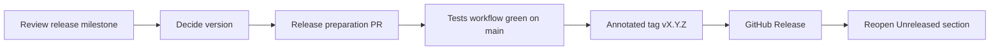

# Release process

This guide defines how a tested commit on `main` becomes a published version:
which version number to choose, what must be true before tagging, how the
annotated tag and GitHub Release are created, what the release notes must
contain, and what to do when a release turns out to be wrong.

Following this guide does not publish anything. Creating a tag is a separate
deliberate act performed by a maintainer.



## Versioned surface

Semantic versioning only means something once the compatible surface is named.
For this repository a version promise covers:

- the names exported from `topology_scheduler`;
- the signatures and documented behavior of those callables, including
  `choose_placement()`, `discover_planner_nodes()`, and the backend execution
  entry points;
- the fields of the public data models, such as `Node`, `Workload`,
  `GPUConnection`, and the Ray node inventory;
- the shape of the machine-readable planning and execution records;
- the backend selectors accepted by `run_with_record()`, currently the names
  `ray` and `kai` plus a caller-supplied callable; and
- the supported Python version and the integration versions pinned in
  `pyproject.toml`.

A version promise does not cover module-private names, the scripts under
`examples/`, test layout and fixtures, documentation wording, or the internal
structure of the policy implementation.

Planner scores are a separate case. The cost model is an experimental input,
not an interface, so tuning a constant is not by itself an incompatible change.
It is still a behavior change: a release that alters which placement the
planner selects for unchanged inputs must say so in the changelog and in the
release notes, because downstream comparisons depend on it.

## Version rules

The project is below 1.0. Under
[Semantic Versioning 2.0.0](https://semver.org/spec/v2.0.0.html), a major
version of zero means the public API is not yet stable. This project adopts
the following additional convention for 0.x; SemVer itself does not require
this convention.

| Change | While 0.x | After 1.0 |
| --- | --- | --- |
| Incompatible change to the versioned surface | minor | major |
| New backwards-compatible capability | minor | minor |
| Fix, documentation, or internal change that leaves the surface intact | patch | patch |

Additional rules:

- A breaking change is never shipped as a patch, even while the project is at
  0.x. Raise the minor version and describe the break under **Compatibility**
  in the release notes.
- Raising a dependency floor or changing a pin, such as the pinned Ray version,
  is at least a minor change because it changes what a user must install.
- Removing an entry from **Known limitations** is not a version bump on its
  own. The change that removed the limitation determines the version.
- Deciding the impact is a human judgment. Nothing in this repository infers a
  version from commit messages or labels, and no tooling should be assumed to.
- Documentation-only work normally waits and ships with the next release rather
  than earning a tag of its own.

Release candidates are optional. When one is useful, tag it `vX.Y.Z-rc.N`,
mark the GitHub Release as a pre-release, and never reuse the candidate number.
The final `vX.Y.Z` is always a separate tag, even when it points at the same
commit as the last candidate.
For a candidate, Python package metadata uses the PEP 440 spelling `X.Y.ZrcN`;
the changelog, Git tag, and GitHub Release use `X.Y.Z-rc.N` (with `v` for the
tag and Release title). These identify the same candidate. Final releases use
exactly `X.Y.Z` in both package metadata and the changelog.

The published 0.1.1 release predates this guide. It added
`discover_planner_nodes()`, which these rules would classify as a minor change.
The rules apply from the next release forward; earlier tags are not revised.

## What blocks a release

The four milestones defined in the [roadmap](roadmap.md) now exist on GitHub:
Topology Discovery, Dynamo Integration, Evaluation, and
[Next Release](https://github.com/LawrenceL05/topology-aware-gpu-scheduling/milestone/4).
Only **Next Release** gates a tag. Before tagging, every selected blocker must
be closed or explicitly deferred with a linked reason and follow-up. Keep
research issues in their original milestones and collect their merged PRs and
evidence in a release-readiness issue in Next Release, as the roadmap requires.
An empty milestone alone is not a readiness review.

The readiness issue records the selected scope, previous tag, proposed version
and rationale, release-preparation PR, exact release commit, CI run links,
validation artifacts, compatibility changes, known limitations, and deferrals.
It may stay open to record the tag and GitHub Release URLs after publication;
it must not leave any pre-publication blocker unresolved. Close it only after
the published artifacts have been verified. Process issue #20 does not itself
authorize a release.

The research milestones do not block a release. Open experimental work is the
normal state of this repository; it is disclosed under **Known limitations** in
the release notes rather than held against the tag.

Independent of any milestone, a release is blocked when:

- the Tests workflow or any other required check is not successful on the
  exact commit to be tagged (missing, pending, cancelled, or skipped required
  checks do not count as passing);
- `python scripts/check_docs.py --run-examples` fails, which also means the
  version table in [current status and versions](current-status.md) has drifted
  from `pyproject.toml` and the contracts;
- the `Unreleased` section of `CHANGELOG.md` does not match the merged code;
- documented behavior in the README or `docs/` no longer matches the code; or
- a known defect makes a documented workflow fail.

Validation claims are their own gate. If the release notes would report
real-GPU results, the evidence must exist and be linked. Where it does not, the
notes state plainly that the feature was exercised only against simulated
logical GPUs, mocked backends, or synthetic inputs.

## Release checklist

Steps 1 through 9 prepare a release through an ordinary pull request. Nothing
is tagged until step 11.

1. Review Next Release and record the scope, blockers, evidence, and deferrals
   in the readiness issue. Close or explicitly defer each pre-publication
   blocker; research milestones may remain open with their limits disclosed.
2. Start from a clean, up-to-date `main` with no staged, unstaged, or untracked
   files. Fetch upstream branches and tags, and confirm current CI is green.
   Prepare changes on a new branch; do not tag that branch.
3. Reconcile `CHANGELOG.md` against what actually merged since the previous
   tag. See [drafting release notes](#drafting-release-notes) for the commands
   that list it. Every user-visible entry needs its implementation pull request
   or merged-commit link, per the documentation update rules in
   [Contributing](../CONTRIBUTING.md).
4. Decide the version using the [version rules](#version-rules) and record the
   reasoning in the release pull request description.
5. Set `version` in `pyproject.toml` to the chosen version.
6. Update the version table in [current status and versions](current-status.md)
   to match, along with any status row the release changes.
7. Convert the `Unreleased` heading to `## [X.Y.Z] - YYYY-MM-DD`, keeping the
   `Added`, `Changed`, `Known limitations`, and `Planned` subsections that
   apply, and update the link definitions at the bottom of the file so
   `[Unreleased]` compares against the new tag and `[X.Y.Z]` compares against
   the previous one.
8. Update the README and any guide in `docs/` whose commands, public API,
   assumptions, or limitations changed.
9. Install the declared dependencies and run `python -m unittest discover -s
   tests -v` and `python scripts/check_docs.py --run-examples` from the repository
   root. Draft the release notes against the preparation branch's current SHA,
   review them manually, and link validation evidence and missing hardware
   coverage in the readiness issue. Reconcile the draft again against the
   selected merge SHA after step 10, before publishing it.
10. Merge the preparation PR and select its resulting `main` commit. Verify
    the Tests workflow and all other required checks on that exact SHA. Record
    the successful run URLs; a green PR head does not validate a merge commit.
11. Verify a clean checkout of that SHA, its presence on `origin/main`, and
    agreement among package version, status table, changelog, and proposed tag.
    Create an annotated tag on that exact SHA using the checks below.
12. Push only that tag and verify the remote tag object and peeled commit.
13. Create the GitHub Release from the existing tag with manually reviewed
    notes. Verify its title, tag, target commit, notes, and pre-release flag;
    record its URL and the tag URL in the readiness issue before closing it.
14. Open a fresh empty `Unreleased` section in `CHANGELOG.md` for the next
    cycle.

## Tagging

Tags are annotated, never lightweight, so that the tagger, date, and release
message are recorded in the object itself. The existing `v0.1.0` and `v0.1.1`
tags are both annotated; that is the standard to keep.

The final tag name is `vX.Y.Z` with a leading lowercase `v` and no other prefix
or suffix; optional candidates use `vX.Y.Z-rc.N` as described above.
The tag message is a single line naming the version and the headline of
the release, following the existing `V0.1.1 automatic GPU inventory` form.

The following commands require Bash, Git, an authenticated GitHub CLI (`gh`),
and upstream release permissions. They are manual maintainer steps, not part
of the offline docs checker. Replace `X.Y.Z` only after reviewing the scope;
the placeholders below are not a version selection. Stop on any failed check.

```bash
git fetch origin main --tags
git switch main
git pull --ff-only origin main
git status --short --untracked-files=all
```

The last command must print nothing. Select the preparation PR's merge SHA
from the readiness issue, rather than assuming the current branch tip is the
reviewed release commit:

```bash
version=X.Y.Z
tag="v$version"
release_commit=REPLACE_WITH_FULL_REVIEWED_MAIN_SHA
git merge-base --is-ancestor "$release_commit" origin/main
git switch --detach "$release_commit"
git status --short --untracked-files=all
gh run list --repo LawrenceL05/topology-aware-gpu-scheduling \
  --workflow tests.yml --branch main --event push --commit "$release_commit" \
  --json databaseId,headSha,status,conclusion,url
gh api "repos/LawrenceL05/topology-aware-gpu-scheduling/commits/$release_commit/check-runs" \
  --paginate --jq '.check_runs[] | [.name, .head_sha, .status, .conclusion, .html_url] | @tsv'
```

Again require an empty status. Inspect the successful completed Tests run with
`gh run view RUN_ID --repo LawrenceL05/topology-aware-gpu-scheduling`; both
`docs` and `test` jobs must succeed. Verify any additional required checks from
the repository's active branch protection/rulesets, including status contexts
if used, against this SHA. An empty run list or missing check blocks tagging.
Record the reviewed SHA and evidence links in the readiness issue.

At this checkout, verify `pyproject.toml`, the version table in
`docs/current-status.md`, and `## [X.Y.Z] - YYYY-MM-DD` in `CHANGELOG.md` all
identify the selected release (using the candidate spelling rule if needed).
Run the documentation checker again. Confirm the selected name is unused both
locally (`git tag --list "$tag"`) and remotely (`git ls-remote --tags origin
"refs/tags/$tag" "refs/tags/$tag^{}"`); both must be empty. Then:

```bash
git tag -a "$tag" "$release_commit" -m "V$version reviewed release"
git cat-file -t "$tag"
git rev-parse "$tag^{commit}"
git show --no-patch "$tag"
git push origin "refs/tags/$tag"
git ls-remote --tags origin "refs/tags/$tag" "refs/tags/$tag^{}"
```

`git cat-file` must return `tag`; the peeled commit must equal
`release_commit`. Compare the remote tag object ID with `git rev-parse "$tag"`
and the remote peeled `^{}` value with `release_commit`. Never force-push.
If publication is interrupted, inspect the existing objects and resume from
the verified tag; do not recreate it or assign it to another commit.

A tag must point at a commit that is on `main` and has a passing Tests run.
Tagging a branch commit, a commit with a failing or missing check, or a commit
that only exists locally is a defect in the release, not a detail to fix later.

## GitHub Release

Create the Release from the pushed tag, titled `vX.Y.Z`, with the notes
described below. The tag is the source of truth; the Release is the readable
presentation of it.

```bash
gh release create "$tag" --repo LawrenceL05/topology-aware-gpu-scheduling \
  --verify-tag --title "$tag" --notes-file "$notes_file"
gh release view "$tag" --repo LawrenceL05/topology-aware-gpu-scheduling \
  --json tagName,name,isDraft,isPrerelease,url,body
```

`notes_file` is the reviewed scratch file prepared below, outside the checkout.
`--verify-tag` prevents the CLI from silently creating a missing tag. Mark
release candidates with `--prerelease`. If Release creation fails after the tag
push, verify that the remote tag is still the reviewed annotated object and
retry Release creation for that same tag.

## Drafting release notes

Start from the changelog section for the version, then check it against what
merged. Neither source is sufficient alone: the changelog can lag, and pull
request titles describe work rather than user-visible behavior.

Use the reviewed `version`, `tag`, and `release_commit` values above. Substitute
the previous release tag for `v0.1.1`:

```bash
previous_tag=v0.1.1
git log --oneline "$previous_tag..$release_commit"
git diff --stat "$previous_tag..$release_commit"
notes_file=$(mktemp)
gh api --method POST \
  repos/LawrenceL05/topology-aware-gpu-scheduling/releases/generate-notes \
  -f tag_name="$tag" -f target_commitish="$release_commit" \
  -f previous_tag_name="$previous_tag" --jq .body > "$notes_file"
```

The generate-notes endpoint drafts text from merged PRs without creating a tag
or publishing a Release; see GitHub's
[generate-notes API](https://docs.github.com/en/rest/releases/releases#generate-release-notes-content-for-a-release).
Reconcile that draft against the version's changelog
section and exact Git range above, then edit the scratch file into the required
sections below. Follow pagination for any supplemental `gh pr list` query;
a date filter alone does not establish inclusion in the release commit. Verify
each linked implementation PR or merged commit is in the selected range,
remove duplicates or reverted changes, and explain user-visible behavior.

Every draft is reviewed by hand before publication. Generated text is a
starting point; the maintainer is responsible for the claims in it, especially
validation claims.

Release notes contain all five sections. Write `None` when no feature or fix
applies, and state explicitly when compatibility is unchanged:

```markdown
## Features
What a user can now do that they could not before.

## Fixes
Defects corrected, with the observable symptom.

## Validation
What was actually run: unit tests, examples, mocked backends, simulated
logical GPUs, or physical hardware. Name the hardware and link the evidence
when a real-GPU run is claimed. Say so plainly when none was run.

## Compatibility
Supported Python version, pinned integration versions, and any incompatible
change with the migration a user must perform.

## Known limitations
What remains unimplemented, unmeasured, or observational, carried forward from
the changelog's known-limitations entries.
```

The **Known limitations** section is not optional padding. This repository is
an experimental foundation, and a release that omits its boundaries overstates
what it does.

## Rollback and corrections

A published tag is immutable. It is never moved, deleted, or reused after a
GitHub Release or any announcement references it. Corrections ship as a new
version.

- **Wrong content in a published release.** Fix it through a PR to `main` and
  release a new version under the version rules (normally a patch, but not if
  the correction changes compatibility). Add a `Fixed` entry naming the
  affected version. For a bad deployment, restore the previous known-good
  version while the correction is prepared; never reset the published tag.
- **A release that should not be used.** Keep the tag, edit the GitHub Release
  body to state at the top that the version is withdrawn and which version
  replaces it, and record the withdrawal in the changelog. Deleting the
  Release hides the warning from anyone who already has the version.
- **A tag pushed by mistake, with no Release and no announcement.** Delete it
  with `git push origin :refs/tags/vX.Y.Z` and tell anyone who may have fetched
  it. That version number is spent: the next attempt uses the next patch
  version, so a given number never describes two different commits.
- **A wrong version number chosen for real content.** Do not retag. Publish the
  correct version next and explain the skip in its changelog entry.
- **A bad state on `main`.** Revert through a pull request like any other
  change. Do not rewrite the history that a published tag points into.

## Current state

[Current status and versions](current-status.md) is the shared summary of what
is implemented and which pins apply; this section covers only what bears on the
next release, and does not restate it.

The repository has annotated tags `v0.1.0` and `v0.1.1` and no published GitHub
Releases. Both tags predate this process and are left as they are. Releases for
them may be created retroactively from their changelog sections, or skipped.

`pyproject.toml` declares `0.1.2` as a development version, and no `v0.1.2` tag
exists. A development version is a placeholder, not a commitment: the value is
decided by the [version rules](#version-rules) at release preparation, not by
the number already sitting in the file.

Review of merged work through
[0265ec6](https://github.com/LawrenceL05/topology-aware-gpu-scheduling/commit/0265ec6)
against `v0.1.1` finds new public capabilities: KAI lifecycle/backend selection
([#13](https://github.com/LawrenceL05/topology-aware-gpu-scheduling/pull/13)),
GPU relationship discovery
([#7](https://github.com/LawrenceL05/topology-aware-gpu-scheduling/pull/7)),
persistent Dynamo replicas
([#30](https://github.com/LawrenceL05/topology-aware-gpu-scheduling/pull/30)),
NIC inventory
([#33](https://github.com/LawrenceL05/topology-aware-gpu-scheduling/pull/33)),
matched policy traces
([#34](https://github.com/LawrenceL05/topology-aware-gpu-scheduling/pull/34)),
and opt-in TCP link measurements
([#27](https://github.com/LawrenceL05/topology-aware-gpu-scheduling/pull/27)).
The Ray pin also changed from 2.49.0 to 2.55.0. Under the project's 0.x rules,
these warrant at least a minor bump; **0.2.0** is the proposed first candidate
version, rather than the development placeholder `0.1.2`.

This review proposes a version, not a release authorization or a package bump.
The readiness review must reconcile all merged work, including later commits,
and confirm compatibility and validation before selecting the final version.
The [single-GPU report](one-gpu-validation.md) is physical inventory/assignment
and CUDA smoke evidence, not inference or multi-node benchmark evidence.
Dynamo inference, live KAI, physical GPU-pair topology, and physical multi-node
TCP measurements remain unverified. They may remain open if explicitly
deferred and disclosed; required validation for the selected scope still gates
the release. This process update creates neither a tag nor a GitHub Release.
